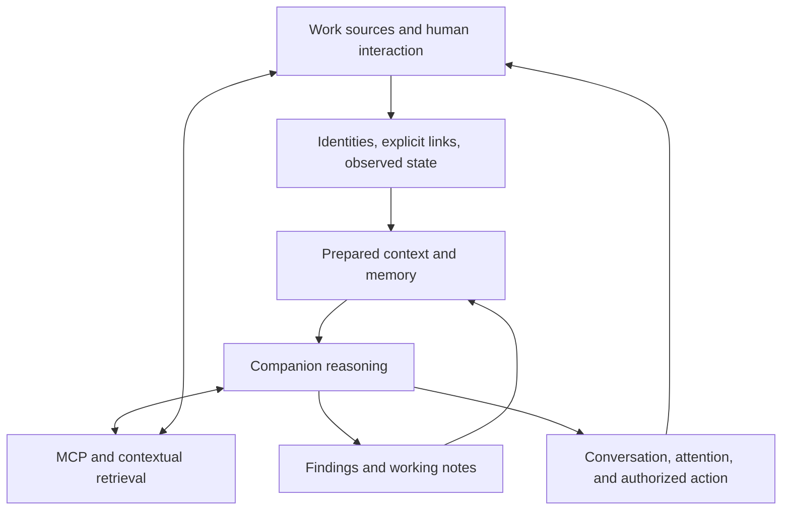

# Desktop companion for ongoing work

- Status: Implementation in progress
- Date: 2026-11-05
- Implementation: Integrated feature under verification

## Purpose

Simple Pet is a desktop companion that understands the work its user is responsible
for and helps move it forward. It maintains an evolving understanding across human
conversations, development sessions, artifacts, and organizational context. It helps
the user stay oriented, remember what matters, make connections, and coordinate
implementation through existing desktop agents.

Companionship is part of the product. The pet is present throughout the workday,
with a personality and a shared understanding of the work. Sometimes it offers an
observation, answers a question, investigates a connection, or follows through on a
delegated task. Sometimes it simply sits there. Useful help and relaxed presence
guide its participation.

Its understanding should support questions such as:

- What are we trying to accomplish, and why?
- What changed, and what did we learn or decide?
- What is waiting on us?
- What would be useful to do next?

Judge each mechanism by whether it improves that understanding, judgment,
follow-through, or interaction with the user. Projects and responsibilities help
organize work without requiring the user to classify every session or artifact.

This directory is the implementation handoff. It contains the product direction,
architecture, specifications, delivery plan, and verification criteria. Its decisions
and examples stand on their own without the planning conversation.

Deliver the complete feature in one coordinated implementation run, using four
specifications and thirteen internal work packages. Use branches and worktrees to
parallelize implementation, integrate the work on one feature branch, and merge the
verified result directly to trunk. Work packages and checkpoints organize the work
within that delivery. They do not require pull requests or separate releases.

The [implementation ledger](implementation.md) records completed component checks
and remaining integrated acceptance. [Verification](verification.md) records bounded
live model results. The repository's trunk is `main`, with `origin/HEAD` pointing to
`origin/main`. Use that verified trunk for the direct merge.

## Context

The Python daemon observes coding sessions and Git/GitHub state, stores reports and
source references, selects commentary, and delivers conversations to the Swift
overlay. Clicking the pet opens persistent typed chat with suggested actions and
Activity. SQLite stores accepted messages independently of renderer presentation.
Source-scoped feedback, navigation, and evidence inspection remain available.

Ambient work subjects use agent session identities. Durable responsibilities and
projects have independent identities. Recorded artifacts and explicit associations
connect evidence across sessions. Desktop control requires a recorded delegation
through the configured adapter. Navigation alone establishes no ownership.

Useful starting points are [application orchestration](../../../pet_daemon/application.py),
[interactions](../../../pet_daemon/interactions.py),
[shared work](../../../pet_daemon/work/shared_work.py), and
[the renderer conversation contract](../../../Sources/PetCore/Conversation.swift).
The [repository guide](../../../AGENTS.md) describes current ownership and checks.
When code and an existing planning document disagree about current behavior, use
the code and update the affected document during implementation.

## Decision

Use the Python Claude Agent SDK for conversation, bounded investigation, tool use,
selected MCP connections, and coordination workflows. Configure the coordinator
with Claude Haiku 5.5, thinking enabled through adaptive thinking, and medium effort.
Keep workspace preparation and desktop harness management behind a configurable
external adapter. The [SDK specification](sdk-workflows.md) owns the model settings
and their mapping to the supported SDK configuration.

The pet owns understanding and follow-through. It can retrieve evidence, research a
dependency, prepare a brief or draft, maintain responsibilities, and delegate bounded
work. Code implementation runs in the user's desktop harness. Claude Code, Codex,
and Cursor remain viable independently of the SDK used inside the pet.

The runtime operates on the Mac while it is awake. Responsibilities survive daemon
restarts within a schema version. Wake and restart trigger reconciliation. Model
requests can use remote APIs, while harness execution and session management remain
on the user's desktop.

Two complementary paths support understanding. The catalog preserves dependable
identities, explicit links, and observed state for preparation. Reasoning can also
search and read accessible sources directly. These are cooperating responsibilities,
not separate services or a mandatory ingestion pipeline:

The feedback path includes human replies and observations from owned desktop
sessions. External effects use the configured adapter and applicable authority.
A meeting passage can inform an inquiry as soon as it is accessible. It does not
need to become a structured decision record before the agent can use it.

SQLite holds canonical conversations, responsibilities, accepted instructions,
task attempts, and follow-ups. Compact working memory holds briefs, discoveries,
open questions, source references, and corrections. Source data is retrieved on
demand through MCPs and local search/read tools, with selected passages and source
revisions retained when they support remembered findings or actions. Exact watches
collect the observations needed to establish their conditions. SDK sessions provide
working context. Application policy establishes ownership, freshness, scope, and
eligibility before a model expresses a finding or requests an effect.

## Information integration

Implement a prepared work brief and context-aware retrieval early in the coordinated
run. The agent begins oriented and can explore beyond that brief through
well-described tools. Use established retrieval and memory patterns, and improve
the feature through normal implementation and acceptance checks before the final
integration and direct merge.

Build the brief from active sessions, recent requests, decisions, progress, open
questions, repository/PR/ticket references, responsibilities, deferred intentions,
requests for human input, and relevant changes since the previous interaction.
Include source availability and freshness. At initial setup, bootstrap from a
bounded amount of configured, accessible harness history and available notes.
Historical imports establish context and never confer harness ownership. Unavailable
or missing information stays explicit while sources refresh.

Supply a source map describing connected collections, project aliases, known
references, and where different kinds of information live. Give the agent useful
examples of inquiries, such as revisiting an open question or checking whether a
changed decision affects current work. These examples guide investigation without
requiring the pet to manufacture an observation.

The retrieval tools provide current work context, context-aware search across
sources, passage reading with surrounding explanation, and relevant changes since
a checkpoint. They handle source selection, independent parallel queries,
deduplication, ranking, and result formatting. Keep selected provider MCP operations
available alongside these curated tools for precise lookups and further exploration.

Rank using explicit identifiers, confirmed relationships, keyword and semantic
relevance, the substance of a decision, freshness and supersession, user corrections,
and source diversity. An older decision can outrank newer status updates. Return
relevant excerpts with source, time, retrieval reason, and an expansion reference.
Retrieval rank expresses relevance. It does not establish that a connection is true.

The pet may investigate connections across recent work and goals before a specific
responsibility is adopted. Read access and relevance govern this discovery.
Adoption governs consequential task actions. Keep tentative connections identifiable
in working memory, retain their sources, and apply corrections to dependent reasoning.
Store enough to resume useful understanding without preinterpreting every source
or constructing a company-wide knowledge model.

## Coordination and memory

The application gathers candidate work from source changes, owned-session results,
due follow-ups, quiet-work reviews, user directions, and restart reconciliation.
It coalesces related causes and manages eligibility, priority, urgency, fair service,
concurrency, and budgets. A noisy source cannot gain more service merely by emitting
more events. Eligible quiet responsibilities retain review deadlines. The model
receives bounded candidate context, judges meaning, and chooses an investigation,
an authorized continuation, a human question, or a recorded wait. Consideration
history records reasons, outcomes, and the condition or time for revisiting work.
The [ongoing loop](responsibilities-and-evidence.md#ongoing-coordination-loop)
defines the policy, including priority overrides and budget-limited deferral.

Working notes retain origin, qualitative evidential support, scope, relevant dates,
supporting references, and lifecycle status. A direct user correction remains
authoritative within its stated scope until explicitly changed or that scope ends.
A model hypothesis remains tentative. A source-supported decision retains its
date, applicability, and supersession. Repeated retrieval or summarization cannot
strengthen a note or turn it into independent evidence. Briefs preserve these
distinctions when compressing history. The
[note lifecycle](responsibilities-and-evidence.md#working-note-lifecycle)
defines revision, rechecking, supersession, rejection, and retention by note kind.

## Human experience

The human-facing behavior is specified in [Conversation and human interaction](conversation.md).
It has three connected surfaces:

- Brief ambient prompts bring a useful finding, outcome, or question to attention
  without taking keyboard focus. Findings remain inspectable after a bubble closes.
- A click opens a compact, persistent text conversation. Suggested continuations
  support questions, clarification, navigation, and concrete task actions. The user
  can type a different instruction or correct the pet's understanding.
- Activity shows responsibilities, investigations, launched harness sessions,
  results, decisions, and deferred intentions. Pausing coordination and stopping a
  delegated agent are distinct actions.

The pet supports resuming work, occasional contextual connections, and conditional
intentions. A short clarification such as whether two sessions belong to the same
project can change its behavior. On-demand catch-up summarizes meaningful changes.
Scheduled roundups and long onboarding questionnaires are outside this delivery.

The pet is the consistent companion the user interacts with. It coordinates
implementation through desktop harnesses and describes outcomes according to the
evidence available. Execution details remain inspectable without dominating every
conversation. Its personality shapes how it participates without manufacturing
urgency or an obligation to speak. The
[conversation specification](conversation.md#companion-voice-and-attribution)
defines natural narration and attribution.

The pet can understand configured, visible work. It can automatically continue a
harness session only when it owns that session and has applicable authority. The
user can inspect and direct that work through the native session.

## Specifications

These documents own the detailed contracts. Implementations and later planning
updates should link to the owning specification rather than redefine its rules.

| Specification | Owned decisions |
| --- | --- |
| [Conversation and human interaction](conversation.md) | Ambient prompts, typed input, suggested actions, durable history, presentation lifecycle, Activity, and human controls. |
| [Responsibilities and evidence](responsibilities-and-evidence.md) | Durable responsibilities, the coordination loop, fair scheduling and reconsideration, note origin/support/lifecycle, bootstrap, retrieval, provenance, and watches. |
| [SDK workflows](sdk-workflows.md) | Haiku thinking/effort configuration, candidate reasoning and dispositions, validated note tools, prepared context, MCP tools, agent lifecycle, cancellation, and response verification. |
| [Desktop sessions](desktop-sessions.md) | External adapter protocol, launch ownership, operation identity, continuation, readiness, and recovery. |

## Scope and operating decisions

Organizational inputs are optional and independently configured. The planned inputs
are a generic read-only ticket-tracking interface, with Linear as its first adapter,
and a local folder of Markdown/plain-text meeting exports, alongside existing coding
sessions, Git, and GitHub. Collect the user's assigned, followed, and linked work,
then retrieve relevant passages on demand. Keep provider-specific ticket features
in adapters and expose optional capabilities explicitly. Do not require a complete
model of the organization or a second ticket provider for this delivery.

The internal SDK receives explicit pet tools and selected MCP capabilities. It has
no direct code-editing or unrestricted shell capability. The desktop adapter owns
workspace creation, terminal choice, harness selection, and session controls.
Personal commands and absolute paths stay outside the public implementation.

The pet may start bounded harness tasks within adopted responsibilities and follow
through those sessions. It observes other sessions for context without acquiring
control through a shared checkout, PR, parent relationship, or similar evidence.
Changes to scope or priority that require the user's judgment return to the human.

Keep existing ambient expression working during delivery. Coordination reasoning
and persona expression can use separate model paths. Preserve the repository's
[prompting principles](../../../.agents/skills/prompting-style/SKILL.md).

Initial scheduling permits one background investigation and one pet-owned coding
task concurrently. Keep time, turn, usage, and concurrency limits configurable.
Follow the repository's reset-and-recreate schema policy. A schema reset clears
responsibilities and authority, even if external harness sessions still exist.

## Work packages and dependencies

Every work package includes focused tests and its configuration/documentation
changes. Package numbers identify work, while dependencies determine implementation
and integration order. Development
can overlap against settled contracts, with integration checks before dependent
work is considered complete. Complete all packages before the direct trunk merge.

| Package | Deliverable and acceptance boundary | Depends on |
| --- | --- | --- |
| 1 | Specifications and shared protocol examples/fixtures. Define prepared context, retrieval results, and successful, failed, stale, and uncertain conversation/adapter operations. | None |
| 2 | Minimal durable conversation, responsibility, note origin/support/scope/history, source-reference, follow-up, candidate/consideration, action-attempt, and Activity records. Verify restart, clearing, and schema reset behavior without requiring a normalized source graph. | 1 |
| 3 | Prepared work briefs, bounded history bootstrap, source maps, and contextual retrieval. Apply scoped corrections and note lifecycle during search/ranking, passage reading, and changes-since tools over existing work, MCP access, and provider fixtures. | 2 |
| 4 | Typed conversation transport and composer, pending/error states, suggested responses, duplicate-submission handling, and close/reopen history. | 2 |
| 5 | Production SDK conversation using Haiku with adaptive thinking and medium effort, prepared context, retrieval, MCP tools, and validated note operations preserving origin and support. Verify first-use orientation, corrections, authority, cancellation, and grounding. | 3, 4 |
| 6 | Generic read-only ticket-tracking interface and first Linear adapter. Connect ticket lookup/search and exact watches to shared identities, retrieval, optional capabilities, and freshness. | 2, 3 |
| 7 | Optional local meeting exports with a searchable passage index, source references, versioned contents, edit/removal handling, and proposal/commitment distinctions. | 2, 3 |
| 8 | Adopt and maintain a responsibility. Watch a specified PR's checks, survive restart, refresh while awake, and report once with evidence. Persist considered revisions, waiting conditions, and review times alongside deferral and correction. | 5 |
| 9 | External desktop adapter client and explicit task launch. Persist dispatch, correlate receipts and hooks, and reconcile uncertain outcomes. Validate a real personal adapter. | 8 |
| 10 | Inspect and continue owned sessions within scope through the shared scheduler. Check readiness and revisions, assess completion evidence, and distinguish coordination pause from available open/stop controls. | 9, 11 |
| 11 | Ongoing coordination: gather/coalesce candidates, apply priorities and urgency, provide fair project/responsibility service, enforce timing/concurrency/budgets, record consideration outcomes and revisits, and invoke scoped cross-source reasoning. | 5, 6, 7, 8 |
| 12 | Full Activity and ambient integration. Coordinate interruptions, conversation, findings, deferred intentions, decisions, and delegated work. | 10, 11 |
| 13 | Integrated acceptance, real desktop checks, configuration/install guidance, adapter examples, and actual generated-response checks. | 12 |

The information integration checkpoint joins packages 3 through 7: a prepared work
brief, persistent typed conversation, contextual retrieval, and the optional ticket
and meeting integrations. Exercise the existing-work path through package 5 while
source adapters progress in parallel. Connect the composer and SDK workflow during
integration. Core retrieval and source grounding are part of this complete delivery.
Broad ongoing inquiry scheduling follows in package 11.

Desktop launch in package 9 and the scheduler in package 11 can progress in
parallel once their dependencies are ready. Integrate both before completing
owned-session follow-through in package 10. Use the shared coordination loop for
continuation rather than a separate temporary event-to-instruction path.

Minimal Activity records begin in package 2 and become inspectable with
responsibility work. Package 8 verifies an adopted watch across restarts. Package
10 verifies launch and follow-through of a real desktop harness session. Package
12 completes ambient and Activity integration. Package 13 verifies the whole feature
before its trunk merge. These are internal checkpoints within one delivery. Tests
and ordinary failure handling accompany each package.

## Worktrees and delegation

Choose one integration branch and worktree from the verified trunk. Settle common
contracts and commit the shared storage foundation there before implementation
streams diverge. Use the user's worktree helpers and repository conventions for
worker branches. Reuse one checkout per active stream, basing dependent work on the
appropriate integration commit. Integrate worker changes in dependency order.

The streams have these ownership boundaries:

| Stream | Responsibility |
| --- | --- |
| Foundation and integration | Shared identities, migrations, contract fixtures, configuration boundaries, application/daemon lifecycle wiring, and integration checkpoints. |
| Conversation | Swift interaction surface, conversation transport, prepared SDK invocation, Haiku workflow configuration, and focused UI/runtime checks. |
| Sources and retrieval | Prepared work brief, history bootstrap, source maps, contextual search/ranking, passage/change tools, ticket-tracking interface, Linear and meeting-export adapters, freshness, and provider checks. Split adapters into separate worktrees when worker capacity permits. |
| Desktop sessions | External adapter client, dispatch attempts, hook correlation, owned-session lifecycle, and adapter checks. |

Use at most three implementation workers alongside the coordinating agent. Rotate
workers as dependencies settle. Give one person or worker ownership of migrations
and shared lifecycle wiring. Feature workers coordinate changes to those files
through that owner.

Each handoff identifies the specification, checkout, base commit, exclusive module
ownership, consumed contracts, acceptance scenario, and required checks. Workers
preserve purposeful concurrent edits and return a concise account of changes,
verification, and unresolved findings. The coordinator maintains this overview,
reconciles integration changes, and arranges independent review.

Use local commits to make worker contributions reviewable and recoverable.
Independent reviews occur at the complete contextual conversation, responsibility
loop, real desktop delegation loop, and final integration. Address findings within
the same implementation run. This workflow has no PR creation, PR publication, or
stack-submission steps.

Before the final merge, account for concurrent trunk changes and run the integrated
checks against the resulting code. Merge the completed feature directly to `main`.
Keep branch and worktree cleanup separate from integration and obtain the required
authorization before destructive cleanup.

The Kitty/worktree adapter is a separate personal task alongside package 9. Its desired
composition is a fresh worktree, a fresh Kitty session, the user's persistent
terminal wrapper, and a chosen native harness. The public contract tests use fake
adapters and must not depend on those personal tools.

## Verification and release acceptance

Use the repository's `make` targets. Run focused Python and Swift tests per work
package, broader architecture/runtime checks at integration checkpoints, and
renderer builds plus real desktop acceptance before the direct trunk merge.
[The Makefile](../../../Makefile) and
[README](../../../README.md) define available checks.

The critical integrated cases are:

- The first invocation receives a useful brief from available current and
  configured historical work, with explicit gaps and source freshness.
- Context search retrieves a relevant earlier decision across sources, deduplicates
  repeated material, and preserves useful source diversity and passage expansion.
- A user correction changes retrieval and remembered connections without rewriting
  source facts. Read-only discovery works before responsibility adoption, while
  task actions still require the adopted scope.
- A noisy project and a noisy responsibility cannot continually reset quiet work's
  review age. Due work, priority overrides, budget exhaustion, and reconsideration
  remain visible in durable scheduling decisions across wake and restart.
- Repeated hypotheses do not gain evidential strength through retrieval or summary.
  Scoped user corrections, source decision dates, supersession, and conflicting
  evidence survive compaction and remain distinguishable in the next brief.
- The SDK receives Haiku with adaptive thinking and medium effort independently
  of the ambient commentary settings and the external harness configuration.
- Closing the panel preserves conversation and responsibility state.
- Sleep cancels appropriate transient work. Wake reconciles without duplicate
  prompts, launches, or continuation instructions.
- New instructions, changed source evidence, and pauses invalidate stale results
  and queued effects.
- Launch or continuation succeeds before the daemon loses its receipt. Restart
  discovers that outcome without submitting the operation again blindly.
- Hook and receipt ordering converges on one explicitly owned session. Unrelated
  sessions never gain ownership through shared artifacts.
- An agent's reported success is assessed against the responsibility's expected
  evidence. Failed refreshes never establish completion.
- Source edits, deletion, unavailable data, and stale data retain their meanings.
- A newly available meeting export cannot establish that its discussion or decision
  happened after a reported implementation. Unknown dates and decision status stay
  explicit during inquiry, delegation, and narration.
- Actual generated responses preserve scope, uncertainty, evidence, and persona.

The complete migration scenario exercises understanding, judgment, and help:

1. The user delegates migration validation, including bounded investigation through
   desktop harnesses. The recorded scope identifies permitted actions and excludes
   rollout.
2. A session reports that its CI check is finished. A meeting discussion about
   staging rollback becomes available. The arrival time establishes when the pet
   gained access to the discussion, without establishing when it occurred.
3. The prepared brief connects the current work and available references. The pet
   retrieves the meeting passage and surrounding context, ticket requirements,
   earlier decisions, and current session/PR evidence. It checks the discussion's
   date and whether the passage records a proposal or an accepted decision.
4. If chronology or decision status remains unknown, the pet records a possible
   conflict with that uncertainty. It can continue read-only investigation. It
   does not present a changed requirement as established merely because notes arrived.
5. If the adopted scope permits it, the pet sends a bounded investigation or
   validation brief through the desktop adapter. The brief includes source
   references, known and unknown dates, the question to answer, constraints, and
   expected evidence. Without that authority, the pet offers the task to the user.
6. The pet follows the owned session, compares reported results with available
   validation evidence, and obtains missing evidence or requests further validation
   within its scope. It returns remaining uncertainty to the user when resolution
   requires human judgment, additional authority, or access unavailable to the pet.
7. The conversation describes the work naturally while preserving what is reported,
   what is supported by verification, and what remains uncertain. The user can
   inspect sources, open the native session, or redirect the work.

## Alternatives

A pet that directly implements code duplicates the user's established harness
workflow and gives the internal agent a different responsibility. Desktop delegation
preserves native sessions, skills, worktree practices, and user intervention.

A cloud-hosted execution service introduces a different deployment and ownership
model. This delivery uses the awake desktop lifecycle and reconciles when it returns.

A pluggable internal agent-runtime framework adds an abstraction without an agreed
second implementation. The SDK choice is opinionated. Desktop adapters and source
configuration remain the public extension boundaries.

A universal workflow language or company-wide knowledge graph is unnecessary for
the agreed responsibilities. Use explicit records, source relationships, and focused
inquiry, extending them when concrete work requires it.
